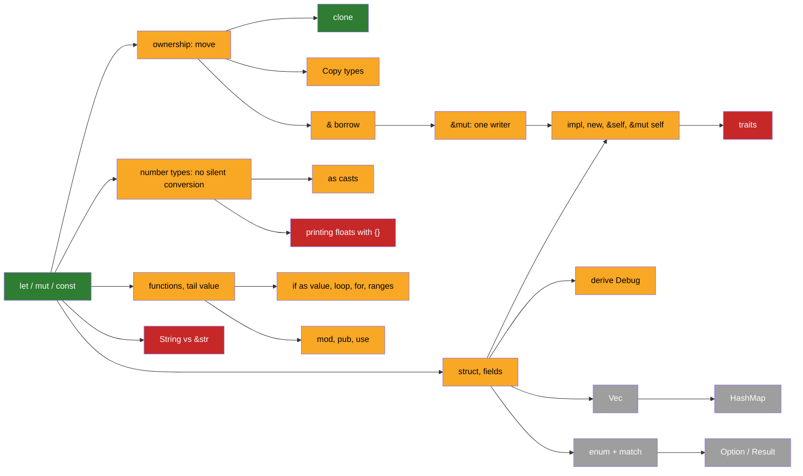

# Memory graph

What the student knows, how firmly, and which question shapes get answers. The teacher
updates it after every answer (rules: `rust-teacher` skill, §8). Colours: green = firm
(3), amber = used and mostly right (2), red = shaky (1), grey = not met yet (0).

## Nodes
| Node | Strength | Last | Evidence, in order | Bring it back as |
|---|---|---|---|---|
| let / mut / const | 3 | 11-15 | E0384 on 10-20; on 11-15 called the E0594 error before the run and named `mut` on the `let` line | every new axis |
| number types | 2 | 11-16 | 10-25 ran `u8 + u16` before guessing; 11-15 expected `x.max = 600` to work on an `f64` ("a"). CODESYS habit: INT to LREAL is automatic; 11-16 wrote `600.0` unaided from the gap | layer counter (u32) times 0.04 |
| as casts | 2 | 10-25 | `port as u8` gave 202, then widened the right way | µm to mm |
| printing floats | 1 | 11-15 | expected `500.0`, got `500` | Z after one layer |
| functions | 2 | 10-20 | tail value, E0308 when `;` added | `in_limits` |
| if / loop / for | 2 | 10-25 | `1..=len` off by one found at runtime | layer loop |
| String vs &str | 1 | 10-25 | asked again what a string literal is | axis names, fault text |
| ownership: move | 2 | 10-25 | thought a moved value is "empty", then predicted E0382 correctly | who owns the drive |
| clone | 3 | 10-25 | predicted the output exactly | copy of a position |
| Copy | 2 | 10-25 | missed on u8, got it in the quiz | passing `pos` |
| & borrow | 2 | 10-25 | `save(&stored)` unaided | `report(&axis)` |
| &mut | 2 | 10-25 | E0499 right after changing the guess; E0502 without a guess | `move_to(&mut axis)` |
| struct | 2 | 11-15 | wrote one on 10-25; read a struct literal on 11-15 | Axis, Laser |
| impl / methods | 2 | 10-25 | wrote `set(&mut self)` unaided | `move_to` |
| derive Debug | 2 | 10-25 | E0774 when put above `use` | print an Axis |
| traits | 1 | 10-26 | idea only (4-20 mA rule); no code; a one-type trait step stalled for 20 days | two types, one `report` |
| mod / pub / use | 2 | 10-22 | E0603 on a private `use` | S2 lib + bin split |
| Vec, HashMap, enum, Option | 0 | | not met | S1 pull sequence |

## How this student thinks
- Types first in the CODESYS way: `NAME : TYPE := value`, implicit numeric conversion, `LEN(x)`.
- Runs before guessing about half the time. A guess asked as one short thing gets given.
- Offers their own fix or variation when the step is concrete. That is the moment to follow.
- Words do not land for layout or abstract ideas; a run or a picture does.
- Analogies that worked: one coil one writer; read-only HMI tag; the 4-20 mA rule; CASE state machine. CODESYS INTERFACE did not.

## Closing forms tried
| Date | Form | Outcome | Note |
|---|---|---|---|
| 11-15 | Predict, three lettered options (`{}` of 500.0) | answered | miss |
| 11-15 | Predict, three lettered options (assign without `mut`) | answered | hit |
| 11-15 | Two-part ask ("which word, which line") | answered with their own idea | gave the fix plus a second variant |
| 11-15 | Teacher ran a variant the student did not mean (`let x = 600`) | turned aside | "not like that": run their idea as typed |
| 11-15 | Predict, two lettered options (`600` into `f64`) | answered | miss |
| 11-15 | Fork with three lettered options incl. "both", right after a miss, on a thing not seen yet (`as f64`) | turned aside | left the step, wrote feedback instead. Said: "some parts of the question turn me aside", "I still know I am hooked" |
| 11-16 | Gap (`x.max = ____;`), repair after a miss | answered | float right (`600.0`); typed `X.max` (phone capital) → E0425, names are case-sensitive |
| 11-16 | Why, size 0 ("Which letter does line 8 need?") | answered | hit: `x`; machine runs, prints `X travels 600` |
